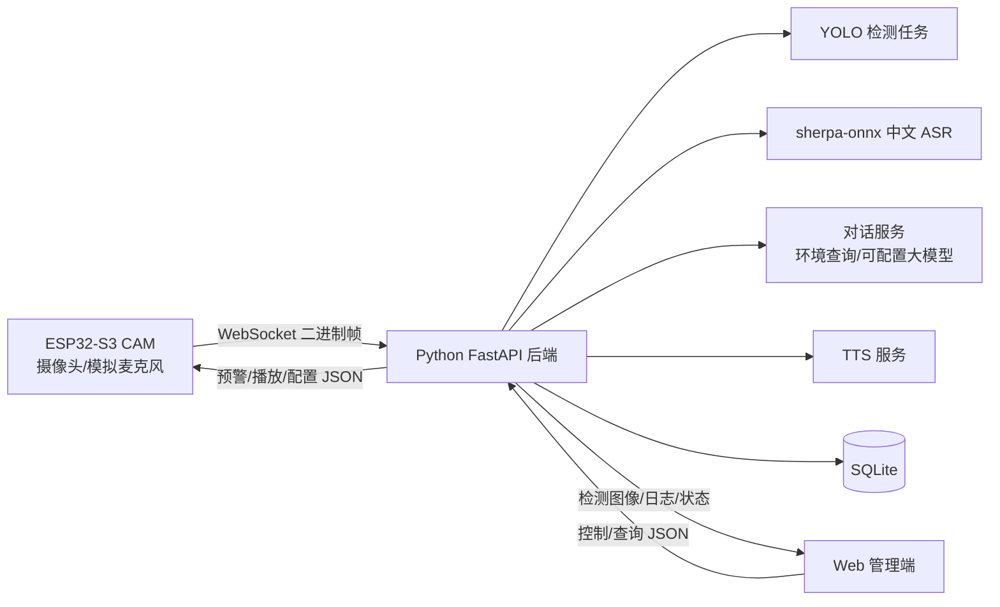
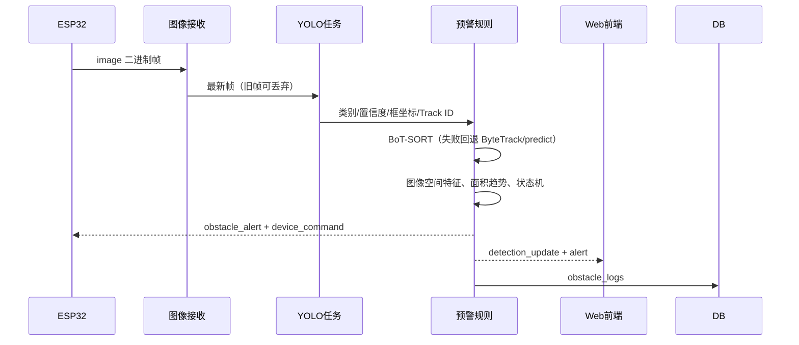
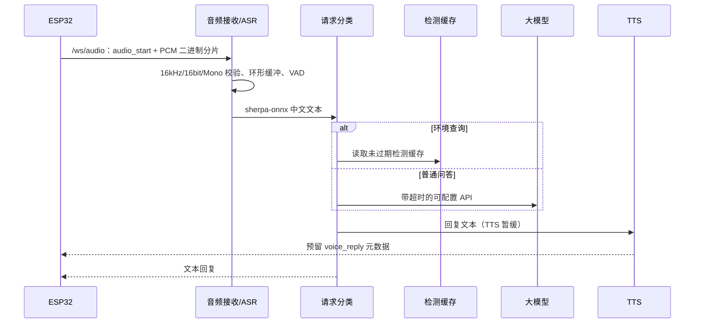

# 系统架构设计

## 1. 总体架构

设备 WebSocket 与网页 WebSocket 使用独立会话。图像和音频走二进制帧，控制、状态、日志走 JSON。所有耗时工作进入独立 asyncio 队列或线程池，确保大模型和语音处理不会阻塞图像预警。

## 2. 后端模块

| 模块 | 职责 | 并发边界 |
|---|---|---|
| DeviceManager | 设备身份、心跳、在线状态、下行队列 | 每设备独立发送队列 |
| ImageReceiver | 校验图像帧、最新帧限流 | 有界队列，丢弃旧帧 |
| DetectionService | 解码、YOLO、方位、检测缓存 | CPU/GPU 线程池 |
| AlertService | 置信度、优先级、连续帧、冷却 | 异步规则引擎 |
| AudioReceiver | PCM 分帧、VAD/触发会话 | 有界音频队列 |
| ASRService | sherpa-onnx 中文识别（WAV/PCM 流） | 独立线程池 |
| DialogueService | 环境查询缓存或大模型 API | 超时与降级 |
| TTSService | 本地 TTS、缓存、优先级播放 | 语音优先级队列 |
| WebBroadcaster | 推送前端状态和结果 | 每网页会话独立队列 |
| Repository | SQLite 记录、筛选、Excel 导出 | 单连接上下文管理 |

## 3. 障碍物预警流程

方位比例默认为左 0–35%、中 35–65%、右 65–100%，但作为服务端参数保存。框中心点用于方位判断，系统不声称测得真实距离。

## 4. 语音交互流程

环境缓存超过 `DETECTION_CACHE_TTL_SECONDS` 时必须明确回复“当前无法获取可靠环境信息”，不能使用过期数据冒充实时结果。

## 5. 数据库结构

- `device_info(device_id PK, name, firmware_version, online, last_heartbeat, camera_ok, mic_ok, left_motor_ok, right_motor_ok, speaker_ok, created_at, updated_at)`
- `obstacle_logs(id PK, device_id, detected_at, object_class, direction, confidence, voice_text, created_at)`
- `voice_logs(id PK, device_id, occurred_at, user_text, reply_text, request_type, asr_status, tts_status, created_at)`
- `system_config(key PK, value_json, scope, updated_at)`
- `system_logs(id PK, level, event, detail, occurred_at)`

时间统一保存为带时区的 ISO 8601 字符串；查询、分页和 Excel 导出均从 SQLite 执行。

## 6. 技术选型

- Python 3.11、FastAPI、Uvicorn、websockets、OpenCV、Ultralytics YOLO、RapidOCR/ONNX Runtime、sherpa-onnx、SQLite、pandas/openpyxl。
- 前端使用原生 HTML/CSS/JavaScript，避免构建链带来的 Windows 部署负担。
- 固件使用 Arduino-ESP32 与 FreeRTOS 任务；ESP32 不运行任何 AI 推理。
- 默认 CPU 推理；检测服务可通过配置切换 CUDA。
